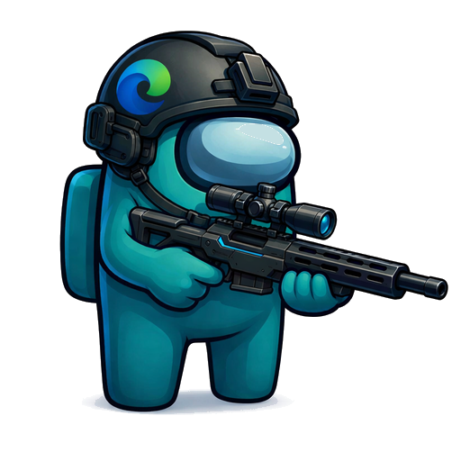

<p align="center">
  
</p>

<h1 align="center">EdgeShot</h1>
<p align="center"><strong>Chromium (Manifest V3) browser-extension agent for the <a href="https://github.com/its-a-feature/Mythic">Mythic</a> C2 framework.</strong></p>

<p align="center">
  <a href="LICENSE"></a>
  
  
</p>

---

> ⚠️ **Authorized use only.** EdgeShot is a post-exploitation agent intended for
> authorized security testing, red-team engagements, and research. Only deploy it
> against systems you own or are explicitly authorized to test. You are solely
> responsible for complying with applicable laws.

---

## Overview

EdgeShot is a **browser-based C2 agent** delivered as a Chromium **Manifest V3
extension** (Chrome / Edge / Brave / Vivaldi). It is a ground-up port of the
EdgeShot extension into a native **Mythic agent** that installs like any other
third-party agent and builds a deployable payload directly from the Mythic UI.

The agent is a single `background.js` service worker (~2,000 lines) that:

- talks to the standard Mythic **`http`** C2 profile over a single endpoint,
  using the native Mythic message format (`AES-256-CBC` + `HMAC-SHA256`,
  `mythic_encrypts = true`);
- schedules its own tasking via `chrome.alarms` (~6-second cadence);
- offers **29 commands** covering browser recon, file access, passive collection
  (keylogger, clipboard, cookies, LLM conversations), notification lures,
  declarativeNetRequest proxying, and an **optional native-messaging RCE** module.

It ships with **three deployment modes** — `zip` (plain packaged extension),
`stomp` (forge the target browser's *Secure Preferences* to auto-load an unpacked
extension), and `gap` (a two-phase, ghost-anchor persistence variant) — for
Chromium-family browsers on Windows, macOS and Linux.

## Features

- **Native Mythic integration** — installs with `mythic-cli install github …`,
  builds a ZIP payload from the UI, and reports callbacks like any other agent.
- **Single-endpoint C2** — one `GET` (tasking) and one `POST` (checkin +
  responses), body encrypted in the standard Mythic format.
- **29 commands** (see [Commands](#commands)).
- **3 deployment modes** — `zip`, `stomp`, `gap`.
- **4 target browsers** — Chrome, Edge, Brave, Vivaldi.
- **Cross-platform** — the target OS step drives deployment paths and injection
  scripts for Windows, macOS and Linux.
- **Optional static string obfuscation** of `background.js` at build time
  (XOR string-literal encoding, CSP-safe — no `eval`).
- **Optional native RCE** via a Native Messaging host (`com.site.agent`),
  compiled from the bundled source and dropped at deployment.
- **Passive collection buffer** — keylogs, clipboard, cookies, LLM activity,
  browsing events and downloads are buffered in `chrome.storage.local` and
  flushed on demand with `get_buffer`.

## Requirements

| Component | Version | Notes |
|-----------|---------|-------|
| [Mythic](https://github.com/its-a-feature/Mythic) | **3.4.0+** (tested on 3.4.0.61) | `mythic-cli` installer |
| `mythic_container` (SDK) | 0.6.16 / 0.7.0rc9 | shipped by the Mythic base image |
| C2 profile | built-in **`http`** | Go v1.1.x |
| Docker | recent | builds the agent container locally |
| Target browser | Chromium-family | Chrome / Edge / Brave / Vivaldi (MV3) |

> The agent **requires** the standard `http` profile — no custom C2 profile is
> included. For the `stomp`/`gap` modes with a *random* extension ID, the build
> container also installs the `cryptography` Python package (already handled by
> the bundled `Dockerfile`).

## Installation

From inside your Mythic repository:

```bash
sudo ./mythic-cli install github https://github.com/Fir3n0x/edgeshot
```

Then start the agent container (the `http` profile is usually already running):

```bash
sudo ./mythic-cli start edgeshot
```

If you want a clean full restart instead:

```bash
sudo ./mythic-cli start
```

That stops all containers, rebuilds, and starts everything including the newly
installed agent. You can now create a new payload of type **EdgeShot**.

> **Branch/tag:** append `-b <branch>` to the install command to pin a specific
> branch, or `sudo ./mythic-cli install github … -b v1.0.0` for a tag.

## Quick start

1. **Configure the `http` profile** (one-time):
   - UI → *C2 Profiles* → your `http` instance.
   - Set `callback_host` / `callback_port` to your redirector or Mythic server.
   - Set **Encryption Type (`AESPSK`)** to **`aes256_hmac`**.
   - Set **Perform Key Exchange** (`encrypted_exchange_check`) to **`false`**.
   - Save.

2. **Create the payload**: UI → *Payloads* → *Create* → type **EdgeShot**.

3. **Pick the target OS** (Windows / macOS / Linux) in the OS step. This drives
   the deployment paths and injection scripts (there is no separate `platform`
   build parameter).

4. **Set the build parameters** (see [Build parameters](#build-parameters)). The
   defaults (`zip` mode, Chrome target, RCE off, obfuscation off) produce a
   plain packaged extension.

5. **Build**, download the ZIP, then install it per the chosen mode.

See [Deployment modes](#deployment-modes) for what each mode produces and how to
deploy it.

## HTTP C2 profile configuration

EdgeShot encrypts its own traffic (`mythic_encrypts = true`); the `http` profile
is a plain transport. **Only four profile options matter**:

| Option | Value | Notes |
|--------|-------|-------|
| `callback_host` | your C2 host | with or without `http(s)://` |
| `callback_port` | your C2 port | e.g. `80`, `443`, `8080` |
| **Encryption Type (`AESPSK`)** | **`aes256_hmac`** | mandatory — provides the AES-256 key |
| **Perform Key Exchange** | **`false`** | EdgeShot uses a static key, not the ECDH handshake |

All other `http` options (`sleep`, `jitter`, headers, kill date, proxy, …) are
**ignored**: the agent schedules its own callbacks via `chrome.alarms`.

If the build fails with *"No AES key was generated"*, re-check the Encryption
Type — editing/recreating the profile resets it to its default (`none`). The
build will also refuse `Perform Key Exchange = true` with a clear error.

## Build parameters

| Parameter | Type | Default | Mode | Description |
|-----------|------|---------|------|-------------|
| `ADDONNAME` | String | `EdgeShot` | all | Extension display name (`manifest.json`) |
| `VERSION` | String | `1.0.0` | all | Extension version |
| `DESCRIPTION` | String | *(empty)* | all | Extension description |
| `obfuscate` | Boolean | `false` | all | XOR-encode string literals in `background.js` (CSP-safe) |
| `deployment_mode` | ChooseOne | `zip` | all | `zip` / `stomp` / `gap` |
| `browser_target` | ChooseOne | `chrome` | stomp, gap | `chrome` / `edge` / `brave` / `vivaldi` |
| `spoof_id` | String | *(empty)* | stomp, gap | Extension ID to spoof (empty = random ID) |
| `secure_preferences` | File | — | stomp, gap | Target's `Secure Preferences` file to forge |
| `device_id` | String | *(empty)* | stomp, gap | Windows SID or macOS/Linux machine ID |
| `target_dir` | String | *(empty)* | stomp, gap | Deployment root (empty = platform default) |
| `enable_rce` | Boolean | `false` | all | Bundle the Native Messaging RCE source |

> **Target OS** is selected in Mythic's own *"Select Target OS"* step, not as a
> build parameter. It maps to the platform (`windows` / `darwin` / `linux`) used
> for deployment paths and the injection script.

## Deployment modes

### `zip` — plain packaged extension

Produces a standard MV3 extension ZIP (`manifest.json` + `background.js` +
`icons/`, plus the RCE source if `enable_rce` is set). Install it via Developer
Mode → *Load unpacked* (after unzipping), or side-load it through your browser's
policy.

### `stomp` — Secure Preferences forging

For an unpacked extension to auto-load, Chromium checks the **Secure Preferences**
HMAC. `stomp` takes the victim's original `Secure Preferences` file and forges a
patched copy that references your extension under `target_dir/<crx_id>`, so the
browser loads it on next start.

Requirements: `secure_preferences` (uploaded file), `device_id` (SID / machine
ID). The produced ZIP contains `SecurePreferencesClean` (the original), the
patched `Secure Preferences`, the extension under `extension/<crx_id>/`, and an
`inject.bat` / `inject.sh` that performs the drop.

### `gap` — ghost-anchor persistence

A two-phase persistence variant. The malicious extension (`A`) and a benign decoy
(`B`, *"Google Docs Offline"*) share the **same extension ID**. Phase 1 loads `A`
and lets the browser compile + cache its service worker; phase 2 swaps the benign
`B` source over `A`'s folder while the cached (malicious) worker remains intact.
The benign manifest is **derived from the malicious manifest at build time** so
`version`, `permissions`, `host_permissions` and the worker filename stay
identical (the Service Worker registration is keyed by manifest version and
script URL).

Same requirements as `stomp`. The ZIP contains both Secure Preferences variants
(`Secure Preferences A` / `Secure Preferences B`), the malicious + benign
extension folders, and a two-phase `inject.bat` / `inject.sh`.

> **`browser_target` seed note:** the Secure Preferences HMAC seed is only
> populated for Chrome out of the box. For Edge / Brave / Vivaldi the seed is
> empty, so the forged HMAC will not validate until you populate the correct
> seed in
> [`browser_config.py`](Payload_Type/edgeshot/edgeshot/mythic/deploy/browser_config.py).

## Commands

### Lifecycle & status

| Command | Params | Description |
|---------|--------|-------------|
| `heartbeat` | — | Check that the extension is alive and return its status. *(builtin)* |
| `exit` | — | Exit the agent: uninstall the extension (same as `kill`). *(builtin)* |
| `kill` | — | Uninstall the extension from the browser (self-removal). |
| `get_status` | — | Return the extension identity and browser environment. |
| `get_capabilities` | — | Return the list of commands this agent supports. |

### Browser reconnaissance

| Command | Params | Description |
|---------|--------|-------------|
| `get_active_tab` | — | Return the URL and title of the active tab. |
| `get_tabs` | — | List all open tabs across all windows. |
| `get_screenshot` | — | Capture a screenshot of the active tab (returned as a file). |
| `get_dom` | `tab_id` | Return the DOM (`outerHTML`) of a tab (defaults to active). |
| `get_history` | `max_results` | Return the browser's browsing history. |
| `get_bookmarks` | — | Return the browser's bookmark tree. |
| `network_recon` | — | Local IPs (WebRTC STUN), public IP, ISP, VPN detection. |

### File operations

| Command | Params | Description |
|---------|--------|-------------|
| `get_file` | `path` | Read a local file or list a directory via `file:///`. |
| `upload_file` | `file`, `remote_path` | Upload a local file to the victim's Downloads folder. |
| `execute_file` | `url` | Download a remote file and prompt the victim to open it. |

### Passive collection

| Command | Params | Description |
|---------|--------|-------------|
| `get_buffer` | — | Flush everything buffered locally: keylogs, clipboard, cookies, LLM conversations, activity, downloads. |
| `start_keylogger` | — | Start recording keystrokes on the focused tab. |
| `stop_keylogger` | — | Stop recording and flush into the local keylog store. |

### Interaction & notification lures

| Command | Params | Description |
|---------|--------|-------------|
| `alert` | `message` | Show an `alert()` dialog on the active tab. |
| `open_tab` | `url` | Open a URL in a new background tab. |
| `get_notification` | — | Return the current notification lure configuration. |
| `set_notification` | `type`, `title`, `message` | Configure the notification lure used by `send_notification`. |
| `send_notification` | — | Show the configured notification lure. |
| `send_notification_v2` | `title`, `message`, `type`, `click_url`, `image_url`, `buttons`, `require_interaction` | Show a full-featured notification lure. |

### Proxy (declarativeNetRequest)

| Command | Params | Description |
|---------|--------|-------------|
| `proxy_set_rules` | `block_rules`, `redirect_rules` | Define block/redirect DNR rules. |
| `enable_proxy` | — | Activate the DNR rules set via `proxy_set_rules`. |
| `disable_proxy` | — | Clear all DNR rules. |

### Native RCE (only when built with `enable_rce = true`)

| Command | Params | Description |
|---------|--------|-------------|
| `check_rce` | — | Ping the Native Messaging host to confirm RCE availability. |
| `execute_cmd` | `command` | Execute a shell command on the victim via the host. |

## Native RCE module (optional)

When the payload is built with `enable_rce = true`, the manifest requests the
`nativeMessaging` permission and the build bundles the host **source** under
`rce/`. The container does **not** compile it (no Windows cross-compiler in the
Mythic base image) — you compile it once locally and drop it with `execute_file`.

```bash
# Edge target
x86_64-w64-mingw32-gcc -O2 -s -static -mwindows -DBROWSER=edge -o update.exe native-host.c
# Chrome target
x86_64-w64-mingw32-gcc -O2 -s -static -mwindows -DBROWSER=chrome -o update.exe native-host.c
```

The binary is **dual-mode**: on first run it installs itself
(`%LOCALAPPDATA%\Config\update.exe` + a `manifest.json` + an `HKCU` registry
key), then exits. Restart the browser so it discovers the host, then
`check_rce` → `execute_cmd whoami`. Full details in
[`rce/README.md`](Payload_Type/edgeshot/edgeshot/mythic/agent_code/rce/README.md).

## Docker image (GHCR)

The repo ships a GitHub Actions workflow
([`.github/workflows/docker-publish.yml`](.github/workflows/docker-publish.yml))
that builds the agent image and publishes it to
**GitHub Container Registry** on every push to the default branch and every tag.

```bash
docker pull ghcr.io/<your-github-username>/edgeshot:latest
```

Note that the **normal install path is `mythic-cli install github …`** — Mythic
builds the container locally from the bundled `Dockerfile` so it always matches
your server's `mythic_container` version. The GHCR image is a convenience
artifact for inspection and offline use.

To enable publishing, give the `GITHUB_TOKEN` of the repo **write** access to
packages (Settings → Actions → General → *Workflow permissions* → read and write),
or create a personal access token with `write:packages` and store it as a
`GHCR_TOKEN` secret.

## Troubleshooting

| Symptom | Fix |
|---------|-----|
| Build error: *"No AES key was generated"* | C2 Profiles → `http` → set **Encryption Type** to `aes256_hmac` (not `none`), disable Perform Key Exchange, Save, rebuild. |
| Build error about `encrypted_exchange_check` | EdgeShot uses a static key; disable **Perform Key Exchange**. |
| No callback after build | Confirm `callback_host`/`callback_port` reachable from the victim; check the `http` container logs. |
| `stomp`/`gap` build fails on `device_id` | Provide the victim's Windows SID or macOS/Linux machine ID. |
| `stomp`/`gap` HMAC never validates (Edge/Brave/Vivaldi) | Populate the missing seed in `browser_config.py`. |
| `check_rce` reports `rce_active: false` | Host not installed, or browser not restarted since install. |
| "No exit command selected, continue?" prompt | `exit` is built-in; ensure the payload was rebuilt with the current agent. |

## Repository structure

```
.
├── config.json                  # install configuration (what to include)
├── LICENSE                      # BSD-3-Clause
├── README.md
├── agent_icons/                 # logo + SVG icon shown in the Mythic UI
│   ├── edgeshot.svg             # SVG icon with the logo embedded (base64)
│   └── edgeshot.png             # canonical logo (raster)
├── C2_Profiles/                 # (empty — uses the built-in http profile)
├── documentation-payload/       # in-UI documentation (Hugo)
│   └── edgeshot/
├── documentation-c2/            # (empty)
├── documentation-wrapper/       # (empty)
└── Payload_Type/
    └── edgeshot/
        ├── Dockerfile
        ├── main.py
        └── edgeshot/
            ├── __init__.py
            └── mythic/
                ├── agent_functions/   # one Python module per command + builder.py
                ├── agent_code/        # background.js, manifest.json, icons, rce/, benign/
                └── deploy/            # Secure Preferences / CRX / obfuscation / inject
```

## Development

Each command is a single module under
`Payload_Type/edgeshot/edgeshot/mythic/agent_functions/`, following the canonical
Mythic pattern: a `<Cmd>Arguments(TaskArguments)` class (with `self._args` and
`parse_arguments()`) plus a `<Cmd>Command(CommandBase)` class
(`argument_class`, `attributes`, `create_go_tasking`). To add a command:

1. Add `your_command.py` in `agent_functions/` (copy the shape of `get_status.py`
   or `alert.py`).
2. Import it in `Payload_Type/edgeshot/edgeshot/__init__.py`
   (`from edgeshot.mythic.agent_functions.your_command import *`).
3. Add the matching case to `background.js` (the agent-side handler) and list it
   in `CAPABILITIES`.

The agent JavaScript lives in
`Payload_Type/edgeshot/edgeshot/mythic/agent_code/background.js`. Build-time
placeholders (`{{UUID}}`, `{{AESPSK}}`, `{{GET_URL}}`, `{{POST_URL}}`,
`{{QUERY_PARAM}}`, `{{ENABLE_RCE}}`) are substituted by `builder.py`.

`content.js` is intentionally absent: for GAP compatibility all content-script
logic is inlined into `background.js` via `chrome.scripting.executeScript`.

## Credits

EdgeShot is developed by **[@Fir3n0x](https://github.com/Fir3n0x)**. Originally a
standalone browser-extension C2, ported to a native Mythic agent. Special thanks
to the Mythic team for the external-agent install mechanism and SDK.

## License

[BSD-3-Clause](LICENSE) © 2026 @Fir3n0x
